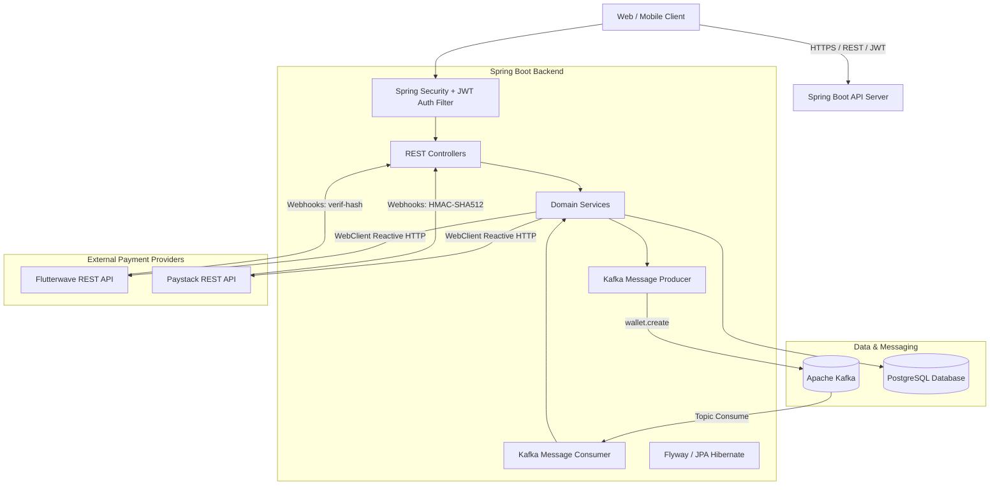
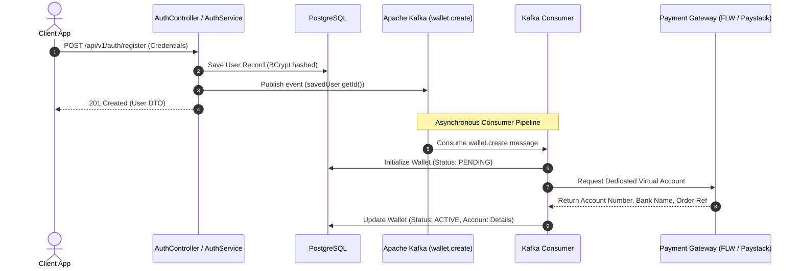
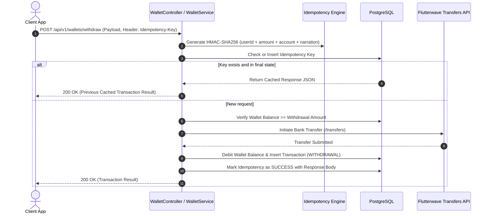

# Paynith Backend

[](https://adoptium.net/)
[](https://spring.io/projects/spring-boot)
[](https://www.postgresql.org/)
[](https://kafka.apache.org/)
[](https://jwt.io/)
[](http://localhost:8080/api/v1/swagger-ui/index.html)

Paynith is an enterprise grade financial technology backend and digital wallet engine built on **Spring Boot 4.0.2** and **Java 17**. The platform powers secure user onboarding, automated virtual bank account issuance, card tokenization, bill payment processing, bank transfers, transactional ledger management, and cryptographic idempotency protection.

---

## Table of Contents

- [Overview](#overview)
- [Architectural Highlights](#architectural-highlights)
  - [Domain-Driven Design (DDD)](#domain-driven-design-ddd)
  - [Event-Driven Architecture (Apache Kafka)](#event-driven-architecture-apache-kafka)
  - [Multi-Provider Factory Pattern](#multi-provider-factory-pattern)
  - [Cryptographic Idempotency Engine](#cryptographic-idempotency-engine)
  - [Webhook Ingestion & Signature Verification](#webhook-ingestion--signature-verification)
- [Architecture & Workflow Diagrams](#architecture--workflow-diagrams)
  - [System Context & Architecture](#system-context--architecture)
  - [User Registration & Async Wallet Provisioning](#user-registration--async-wallet-provisioning)
  - [Idempotent Withdrawal Processing](#idempotent-withdrawal-processing)
- [Core Features](#core-features)
- [Technology Stack](#technology-stack)
- [Repository Structure](#repository-structure)
- [Prerequisites](#prerequisites)
- [Environment Configuration](#environment-configuration)
- [Infrastructure Setup (Docker Compose)](#infrastructure-setup-docker-compose)
- [Building and Running](#building-and-running)
- [Comprehensive API Reference](#comprehensive-api-reference)
  - [Authentication (`/auth`)](#authentication-auth)
  - [Users (`/users`)](#users-users)
  - [Wallets (`/wallets`)](#wallets-wallets)
  - [Payments (`/payments`)](#payments-payments)
  - [Cards (`/cards`)](#cards-cards)
  - [Bills & Utilities (`/bills`)](#bills--utilities-bills)
  - [Transactions & Ledger (`/transactions`)](#transactions--ledger-transactions)
  - [Webhooks (`/webhooks`)](#webhooks-webhooks)
- [Standard Response Envelope & Error Handling](#standard-response-envelope--error-handling)
- [Security & Authentication](#security--authentication)
- [License](#license)

---

## Overview

Modern digital financial systems demand high reliability, transaction integrity, and robust fraud defense. Paynith solves these challenges by combining:

1. **Transactional Ledger Integrity**: Precise balance mutations backed by transactional guarantees.
2. **Pluggable Payment Rail Integration**: Seamless connectivity with major payment aggregators like Flutterwave and Paystack.
3. **Double-Spend & Duplicate Request Prevention**: In-memory and database level idempotency verification via HMAC request hashing.
4. **Resilient Asynchronous Messaging**: Event-driven decoupling of registration from downstream third-party provider calls.

---

## Architectural Highlights

### Domain-Driven Design (DDD)
The codebase is structured around explicit business domains:
- **`domain.auth`**: User credential validation, token generation, and secure password hashing.
- **`domain.user`**: Profile data and identity records.
- **`domain.wallet`**: Balance accounting, funding, debits, bank transfers, and account resolutions.
- **`domain.payment`**: Payment orchestration (wallet balance payments, card charges, utility debits).
- **`domain.card`**: Tokenized card persistence, 3DS payment confirmation, and lifecycle management.
- **`domain.bill`**: Biller categories, package lookups, customer validation, and bill purchases.
- **`domain.transaction`**: Complete auditable history of credits, debits, payments, withdrawals, and reversals.
- **`domain.virtualaccount`**: Abstraction layer for dynamic virtual bank account generation.
- **`domain.idempotency`**: Cryptographic payload verification and distributed operation state tracking.
- **`domain.webhook`**: Provider event reception, HMAC verification, and asynchronous settlement.

### Event-Driven Architecture (Apache Kafka)
When a user registers:
- The user record is persisted inside a database transaction.
- An event with the user ID is published to the `wallet.create` Kafka topic.
- A dedicated Kafka consumer (`MessageConsumer`) ingests the message and triggers virtual account generation via the configured payment gateway asynchronously.
- Registration returns immediately without blocking on external provider latency.

### Multi-Provider Factory Pattern
Virtual account allocation and webhook routing use factory designs:
- `VirtualAccountProviderFactory` resolves either `FLUTTERWAVE` or `PAYSTACK` based on the `app.va.provider` property.
- `WebhookProviderFactory` resolves provider-specific event handlers dynamically, allowing support for additional gateways without modifying core controllers.

### Cryptographic Idempotency Engine
To prevent race conditions, repeated clicks, or network duplicate retries on critical financial calls (such as withdrawals):
- The client passes a unique `Idempotency-Key` header.
- The server generates an HMAC-SHA256 signature from `userId|amount|accountNumber|narration` using `withdrawal.hash.secret`.
- If an operation with the same key is already completed, the cached response payload is immediately returned from the database without re-executing the payment.
- If the payload differs for an identical idempotency key, the request is rejected immediately with an integrity violation error.

### Webhook Ingestion & Signature Verification
- **Flutterwave**: Validates webhook authenticity using the secret hash passed in the `verif-hash` request header.
- **Paystack**: Computes and validates cryptographic HMAC-SHA512 signatures via the `x-paystack-signature` header against the raw payload.
- **Reconciliation & Auto-Refund**: Unsuccessful outbound transfers trigger automatic balance refunds to user wallets while marking ledger entries as failed.

---

## Architecture & Workflow Diagrams

### System Context & Architecture



### User Registration & Async Wallet Provisioning



### Idempotent Withdrawal Processing



---

## Core Features

- **Authentication & Security**
  - BCrypt password hashing.
  - Stateless JWT token issuing and authentication with custom `JwtAuthFilter`.
  - Configurable Cross-Origin Resource Sharing (CORS) policies.
  - Role and token validation on all private routes.

- **Digital Wallet & Virtual Accounts**
  - Unique dedicated virtual bank account number provisioning for each user.
  - Multi-provider support for Flutterwave and Paystack.
  - Real-time wallet balance queries and transaction summaries.
  - Total credited and total debited ledger statistics.

- **Bank Transfers & Account Resolution**
  - Fetch supported commercial banks in Nigeria.
  - Real-time account name verification before initiating disbursements.
  - Cryptographically guarded outbound bank withdrawals.

- **Card Payments & Tokenization**
  - Direct debit card charges with 3DS/OTP verification support.
  - Tokenized card persistence for reusable, one-click checkouts.
  - Set default payment card and delete linked cards.
  - Direct wallet funding via saved payment cards.

- **Utility & Bill Payments**
  - Discovery of bill categories (Airtime, Internet Data, Cable TV, Power Utilities).
  - Biller selection and package query by biller code.
  - Customer account validation (e.g. Meter Number, Smartcard ID).
  - Bill payment execution with webhook tracking and debit ledger adjustments.

- **Transaction Ledger**
  - Complete auditable ledger tracking credits, debits, payments, withdrawals, and refunds.
  - Paginated transaction query with multi-field filtering (transaction type, status, references).
  - Automated refunds upon webhook transfer failure notification.

- **Webhooks & Settlement**
  - Cryptographic verification of Flutterwave and Paystack webhooks.
  - Automated balance credits upon bank transfer deposits to virtual accounts.
  - Webhook deduplication based on unique provider references.

---

## Technology Stack

| Category | Technology | Version / Details |
|---|---|---|
| **Language** | Java | 17 (LTS) |
| **Framework** | Spring Boot | 4.0.2 |
| **Web & Routing** | Spring MVC & Spring WebFlux | Reactive WebClient for external HTTP calls |
| **Security** | Spring Security, JJWT | `jjwt-api`, `jjwt-impl`, `jjwt-jackson` (0.11.5) |
| **Persistence** | Spring Data JPA / Hibernate | Object-Relational Mapping (ORM) |
| **Database** | PostgreSQL | 15 (Docker or standalone) |
| **Migrations** | Flyway | Flyway Core database versioning |
| **Messaging** | Apache Kafka | `spring-boot-starter-kafka` (Producer & Consumer) |
| **Documentation** | Springdoc OpenAPI UI | 2.8.6 (Swagger UI 3.0 compatible) |
| **Build Tool** | Apache Maven | Maven 3.x with Maven Wrapper (`./mvnw`) |
| **Utilities** | Project Lombok, Jackson | Boilerplate reduction and JSON serialization |

---

## Repository Structure

```
paynith/
├── .env                              # Environment variable configuration file
├── docker-compose.yaml               # Docker Compose file for Postgres and Kafka
├── mvnw                              # Maven Wrapper script (Linux / macOS)
├── mvnw.cmd                          # Maven Wrapper batch file (Windows)
├── pom.xml                           # Project Object Model dependencies
├── README.md                         # Comprehensive documentation
├── src/
│   ├── main/
│   │   ├── java/com/king/paynith/
│   │   │   ├── PaynithApplication.java
│   │   │   ├── config/               # Security, CORS, and Swagger configurations
│   │   │   │   ├── CorsConfig.java
│   │   │   │   ├── SecurityConfig.java
│   │   │   │   └── SwaggerConfig.java
│   │   │   ├── domain/               # Domain-Driven Design core business modules
│   │   │   │   ├── auth/             # Registration, Login, Token generation
│   │   │   │   ├── bill/             # Bill categories, items, bill payments
│   │   │   │   ├── card/             # Direct charges, card linking, token storage
│   │   │   │   ├── idempotency/      # Idempotency storage, state validation
│   │   │   │   ├── payment/          # Wallet payments, card payments, deposits
│   │   │   │   ├── transaction/      # Ledger transactions, queries, pagination
│   │   │   │   ├── user/             # User profiles and entity management
│   │   │   │   ├── virtualaccount/   # Multi-provider virtual account interfaces
│   │   │   │   ├── wallet/           # Balance mutations, withdrawals, validations
│   │   │   │   └── webhook/          # Multi-provider webhook processors
│   │   │   ├── infrastructure/       # External service and client adapters
│   │   │   │   ├── flutterwave/      # Flutterwave WebClient and VA provider
│   │   │   │   ├── kafka/            # Kafka producers and topic listeners
│   │   │   │   └── paystack/         # Paystack WebClient and VA provider
│   │   │   └── shared/               # Cross-cutting utilities and response wrappers
│   │   │       ├── exception/        # Global exception handler
│   │   │       ├── interceptor/      # JWT auth filter and response interceptor
│   │   │       ├── response/         # Response<T> and PaginatedResponse<T>
│   │   │       └── util/             # JWT, JSON, and Authentication helpers
│   │   └── resources/
│   │       ├── application.properties
│   │       └── db/migration/         # Flyway SQL migration scripts
│   └── test/
│       └── java/com/king/paynith/
│           └── PaynithApplicationTests.java
```

---

## Prerequisites

Ensure the following tools are installed on your machine before running the application:

- **Java Development Kit (JDK)**: Java 17 or higher ([Eclipse Temurin / OpenJDK](https://adoptium.net/))
- **Docker & Docker Compose**: For launching PostgreSQL and Kafka dependencies locally ([Docker Desktop](https://www.docker.com/))
- **Git**: For version control management

---

## Environment Configuration

Create a `.env` file in the project root directory. Use the following environment variables template:

```env
# ==========================================
# DATABASE CONFIGURATION
# ==========================================
POSTGRES_DB_URL=jdbc:postgresql://localhost:5434/paynith_db
POSTGRES_DB=paynith_db
POSTGRES_USER=paynith
POSTGRES_PASSWORD=paynith321

# ==========================================
# APACHE KAFKA CONFIGURATION
# ==========================================
KAFKA_BOOTSTRAP_SERVERS=localhost:9092

# ==========================================
# PAYMENT GATEWAY INTEGRATIONS
# ==========================================
# Flutterwave Secret Key and Webhook Hash
FLUTTERWAVE_SEC_KEY=FLWSECK_TEST-your_flutterwave_secret_key
FLUTTERWAVE_WEBHOOK_HASH=your_flutterwave_webhook_hash

# Paystack Secret Key
PAYSTACK_SEC_KEY=sk_test_your_paystack_secret_key

# ==========================================
# SECURITY & CRYPTOGRAPHY
# ==========================================
# 256-bit or 512-bit Secret Key for signing JWT tokens
JWT_SEC_KEY=your_secure_random_jwt_secret_key_at_least_256_bits

# Secret Key for generating HMAC-SHA256 withdrawal request hashes
WITHDRAWAL_HASH_SEC=your_secure_withdrawal_hmac_hash_secret_key
```

### Environment Variable Descriptions

| Variable | Description | Example / Default |
|---|---|---|
| `POSTGRES_DB_URL` | JDBC connection URL for PostgreSQL database | `jdbc:postgresql://localhost:5434/paynith_db` |
| `POSTGRES_DB` | Name of the PostgreSQL database | `paynith_db` |
| `POSTGRES_USER` | PostgreSQL database username | `paynith` |
| `POSTGRES_PASSWORD` | PostgreSQL database password | `paynith321` |
| `KAFKA_BOOTSTRAP_SERVERS` | Host and port of the Apache Kafka broker | `localhost:9092` |
| `FLUTTERWAVE_SEC_KEY` | Secret API key provided by Flutterwave | `FLWSECK_TEST-xxxxxxxxxxxx` |
| `FLUTTERWAVE_WEBHOOK_HASH` | Secret hash to verify incoming Flutterwave webhooks | Configured in FLW Dashboard |
| `PAYSTACK_SEC_KEY` | Secret API key provided by Paystack | `sk_test_xxxxxxxxxxxx` |
| `JWT_SEC_KEY` | Cryptographic secret key used to sign and verify JWT tokens | 64-char Hex string |
| `WITHDRAWAL_HASH_SEC` | Secret key used for withdrawal idempotency HMAC hashes | 64-char Hex string |

---

## Infrastructure Setup (Docker Compose)

The repository provides a `docker-compose.yaml` file configured for PostgreSQL 15 and Apache Kafka in KRaft mode (no Zookeeper required).

1. Start all supporting services in detached mode:
   ```bash
   docker compose up -d
   ```

2. Confirm both containers are healthy and running:
   ```bash
   docker compose ps
   ```

   - **PostgreSQL**: Bound to host port `5434` (mapped to container port `5432`).
   - **Kafka**: Bound to host port `9092` (advertised as `PLAINTEXT://localhost:9092`).

3. Stop the services when finished:
   ```bash
   docker compose down
   ```

---

## Building and Running

### 1. Build the Application
Compile the code, resolve dependencies, and package the JAR file using Maven Wrapper:

- **Linux / macOS**:
  ```bash
  ./mvnw clean install
  ```

- **Windows**:
  ```cmd
  mvnw.cmd clean install
  ```

### 2. Run the Server
Launch the Spring Boot application locally:

- **Linux / macOS**:
  ```bash
  ./mvnw spring-boot:run
  ```

- **Windows**:
  ```cmd
  mvnw.cmd spring-boot:run
  ```

The server boots with the context path `/api/v1` on port `8080`.

### 3. Access Interactive API Documentation
Once the server is running, explore and test the endpoints directly via the Swagger UI:

- **Swagger UI**: [http://localhost:8080/api/v1/swagger-ui/index.html](http://localhost:8080/api/v1/swagger-ui/index.html)
- **OpenAPI JSON Docs**: [http://localhost:8080/api/v1/v3/api-docs](http://localhost:8080/api/v1/v3/api-docs)

---

## Comprehensive API Reference

All routes are prefixed with the servlet context path: `/api/v1`.

### Authentication (`/auth`)

Public routes for account creation and login session management.

| Method | Endpoint | Access | Description |
|---|---|---|---|
| `POST` | `/auth/register` | Public | Register a new user account and trigger async wallet generation |
| `POST` | `/auth/login` | Public | Authenticate with email and password to receive a JWT Bearer token |

#### Register Payload Example
```json
{
  "firstName": "John",
  "lastName": "Doe",
  "email": "john.doe@example.com",
  "phoneNumber": "08012345678",
  "password": "SecurePassword123!"
}
```

---

### Users (`/users`)

User management endpoints. Requires `Authorization: Bearer <token>`.

| Method | Endpoint | Access | Description |
|---|---|---|---|
| `GET` | `/users/{id}` | Authenticated | Retrieve user profile by user ID |
| `PATCH` | `/users/{id}` | Authenticated | Update user profile details |

---

### Wallets (`/wallets`)

Wallet queries, bank transfers, and account validation. Requires `Authorization: Bearer <token>`.

| Method | Endpoint | Access | Description |
|---|---|---|---|
| `GET` | `/wallets` | Authenticated | Retrieve current authenticated user's wallet and virtual account details |
| `GET` | `/wallets/{id}` | Authenticated | Retrieve specific wallet by its unique ID |
| `POST` | `/wallets/withdraw` | Authenticated | Initiate withdrawal transfer to a bank account (requires `Idempotency-Key` header) |
| `GET` | `/wallets/banks` | Authenticated | Retrieve a list of Nigerian commercial banks and bank codes |
| `POST` | `/wallets/verify-account` | Authenticated | Resolve account name for an account number and bank code |

#### Withdrawal Payload Example
```http
POST /api/v1/wallets/withdraw HTTP/1.1
Authorization: Bearer <your_jwt_token>
Idempotency-Key: 7b84f39b-1e7d-42bc-9d22-1c251d141e88
Content-Type: application/json

{
  "accountBank": "044",
  "accountNumber": "0123456789",
  "accountName": "John Doe",
  "amount": 5000.00,
  "currency": "NGN",
  "narration": "Transfer to savings"
}
```

---

### Payments (`/payments`)

Payment orchestration for wallet balance debits and linked card transactions. Requires `Authorization: Bearer <token>`.

| Method | Endpoint | Access | Description |
|---|---|---|---|
| `POST` | `/payments/pay/wallet` | Authenticated | Pay for services directly from internal wallet balance |
| `POST` | `/payments/deposit/card` | Authenticated | Fund internal wallet using a saved, tokenized debit card |
| `POST` | `/payments/pay/card` | Authenticated | Execute direct payment using a saved, tokenized debit card |

---

### Cards (`/cards`)

Card linking, direct charge verification, tokenized card management. Requires `Authorization: Bearer <token>`.

| Method | Endpoint | Access | Description |
|---|---|---|---|
| `POST` | `/cards/direct-charge` | Authenticated | Initiate first-time direct card charge to acquire token (with OTP/3DS flow) |
| `POST` | `/cards/confirm` | Authenticated | Confirm transaction reference after 3DS validation to save card token |
| `GET` | `/cards` | Authenticated | List all active cards linked to the authenticated user |
| `PATCH` | `/cards/{id}/default` | Authenticated | Set a specific linked card as the user's default payment card |
| `DELETE` | `/cards/{id}` | Authenticated | Unlink and soft delete a card |

---

### Bills & Utilities (`/bills`)

Lookup and purchase airtime, data bundles, power, and cable subscriptions via Flutterwave.

| Method | Endpoint | Access | Description |
|---|---|---|---|
| `GET` | `/bills/categories` | Authenticated | List top utility bill categories in Nigeria (NG) |
| `GET` | `/bills/categories/{categoryCode}/billers` | Authenticated | List available billers under a category |
| `GET` | `/bills/billers/{billerCode}/items` | Authenticated | List specific bill packages and item codes for a biller |
| `GET` | `/bills/bills/items/{itemCode}/validate` | Authenticated | Validate customer meter number, phone, or smartcard number |
| `POST` | `/bills/{billerCode}/items/{itemCode}/payment` | Authenticated | Initiate utility bill payment |

---

### Transactions & Ledger (`/transactions`)

Transaction history, status transitions, and analytical balances. Requires `Authorization: Bearer <token>`.

| Method | Endpoint | Access | Description |
|---|---|---|---|
| `GET` | `/transactions` | Authenticated | Retrieve paginated list of transactions with optional filters (`type`, `status`, `reference`, `providerRef`, `page`, `size`) |
| `GET` | `/transactions/{transactionId}` | Authenticated | Retrieve single transaction details by ID |
| `GET` | `/transactions/wallet/{walletId}` | Authenticated | Retrieve all transactions recorded for a specific wallet ID |
| `PATCH` | `/transactions/{transactionId}/success` | Authenticated | Mark a transaction status as SUCCESSFUL |
| `PATCH` | `/transactions/{transactionId}/failed` | Authenticated | Mark a transaction status as FAILED with a reason string |
| `PATCH` | `/transactions/{transactionId}/reversed` | Authenticated | Mark a transaction status as REVERSED |
| `GET` | `/transactions/wallet/{walletId}/total-credited` | Authenticated | Calculate total lifetime amount credited to the wallet |
| `GET` | `/transactions/wallet/{walletId}/total-debited` | Authenticated | Calculate total lifetime amount debited from the wallet |

---

### Webhooks (`/webhooks`)

Public gateway endpoints secured by cryptographic signature checks.

| Method | Endpoint | Verification Header | Description |
|---|---|---|---|
| `POST` | `/webhooks/flutterwave` | `verif-hash` | Ingest Flutterwave charge, transfer, refund, and virtual account credit events |
| `POST` | `/webhooks/flutterwave/bill-payment` | `verif-hash` | Ingest Flutterwave utility bill payment status updates |
| `POST` | `/webhooks/paystack` | `x-paystack-signature` | Ingest Paystack dedicated virtual account assignments and charge webhooks |

---

## Standard Response Envelope & Error Handling

All controller responses return a uniform response envelope (`Response<T>`):

### Successful Response Format
```json
{
  "success": true,
  "statusCode": 200,
  "message": "Wallet retrieved successfully",
  "data": {
    "id": "550e8400-e29b-41d4-a716-446655440000",
    "currency": "NGN",
    "balance": 150000.00,
    "status": "ACTIVE",
    "accountNumber": "9876543210",
    "bankName": "Wema Bank"
  }
}
```

### Paginated Response Format (`PaginatedResponse<T>`)
```json
{
  "success": true,
  "statusCode": 200,
  "message": "Transactions retrieved",
  "data": {
    "content": [ ... ],
    "page": 0,
    "size": 20,
    "totalElements": 45,
    "totalPages": 3,
    "last": false
  }
}
```

### Error Response Format
Handled globally by `GlobalExceptionHandler`:
```json
{
  "success": false,
  "statusCode": 400,
  "message": "Insufficient balance",
  "data": null
}
```

---

## Security & Authentication

1. **Stateless Session Management**: Spring Security is configured with `SessionCreationPolicy.STATELESS`. No session cookies are maintained.
2. **Bearer Token Authentication**: Each request to protected endpoints must include:
   ```http
   Authorization: Bearer <your_jwt_token>
   ```
3. **Password Security**: Passwords are saved with strong `BCryptPasswordEncoder` hashing before persistence.
4. **CORS Control**: Allowed origins, allowed headers, and methods are centrally configured in `SecurityConfig` and `application.properties`.
5. **Webhook Protection**:
   - Flutterwave checks compare incoming `verif-hash` header against `flutterwave.webhook.hash`.
   - Paystack checks verify the payload with `HmacSHA512` using `paystack.secret.key`.

---

## License

Copyright (c) 2026 Faithful001. All rights reserved.

This software and associated documentation files are proprietary and confidential to Faithful001. Unauthorized copying, modification, distribution, sublicensing, or publication of this software via any medium is strictly prohibited. See the [LICENSE](LICENSE) file for complete terms.
